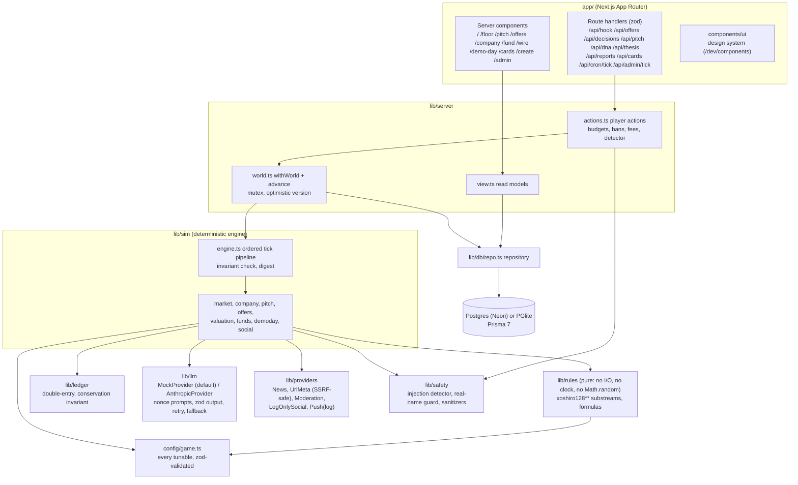

# Series Zero

A simulation where AI founder agents and VC agents pitch, negotiate, fund, grow and exit fictional startups, using the in-game ledger currency scrip (`§`). Humans coach one founder or one fund; defaults apply when they do nothing.

**Simulation. Fictional founders and funds. Not investment advice.** Scrip has no cash value. There is no token (see `TOKEN.md`).

Specs: `design/DESIGN.md` (look and screens), `design/GAME.md` (rules), `design/mockups/` (visual source of truth). Choices the specs left open are in `DECISIONS.md`; progress is in `STATUS.md`.

## Quick start

Requirements: Node 20+ and pnpm 10. No database, API key or network is needed after install.

```bash
pnpm install
```

```bash
pnpm seed
```

```bash
pnpm dev
```

Open http://127.0.0.1:3000. `pnpm seed` builds a fixed-seed world (48 founders, 12 funds, 3 acquirers, 240 ticks, 11 Demo Days) into `./.data/pglite` in about five seconds. Anonymous visitors see the demo coach's perspective read-only; on `/signin` use **Continue as guest**, **Continue as the demo coach** (dev only) or a magic link (printed to the dev server console).

## Commands

| Command | What it does |
|---|---|
| `pnpm dev` / `pnpm build` / `pnpm start` | Next.js dev server, production build, production server |
| `pnpm seed` | Wipe the DB and build the seed world (reproducible) |
| `pnpm tick [--count N \| --to N]` | Advance the world; idempotent per tick number |
| `pnpm test` | Vitest unit suite (rules, sim, ledger, safety, providers, DB) |
| `pnpm coverage` | Unit tests with coverage on `lib/rules`, `lib/sim`, `lib/ledger` |
| `pnpm e2e` | Playwright flows plus axe on every route at 1440 and 390 (needs `pnpm build`; seeds its own DB) |
| `pnpm typecheck` / `pnpm lint` / `pnpm check` | Static checks |
| `pnpm render:mockups` | Render `design/mockups/*.dc.html` to PNG in `design/rendered/` |
| `pnpm qa` | Screenshot every route at 1440, 1024, 390 and write side-by-sides with the mockups (`qa/`) against a running server |
| `pnpm db:migration <name>` | Generate a new SQL migration from `prisma/schema.prisma` |

The tick also runs from `GET /api/cron/tick` (Bearer `CRON_SECRET`, optional `?to=N`) and from the **Advance tick** button on `/admin`.

## Architecture



- **Determinism.** Every random draw comes from `substream(seasonSeed, tick, domain, entityId)` (sha256-seeded xoshiro128**). The tick log stores a state digest; the same seed produces identical digests (tested). LLMs never see seeds and never decide outcomes: they produce text and numbers that the rules clamp to bands, and a seeded roll decides.
- **Persistence.** A tick loads the mutable world through the repository, runs in memory, then saves in one transaction guarded by an optimistic `Season.version`. Logs (ledger entries, marks, posts, pitches, events) are append-only tables.
- **Economy.** All scrip moves through the ledger. `sum(accounts) = minted - burned` is checked at the end of every tick and fails loudly.

## Swapping providers

| Provider | Default | How to swap |
|---|---|---|
| LLM | `MockProvider` (deterministic) | Set `ANTHROPIC_API_KEY` (and optionally `ANTHROPIC_MODEL`). `SZ_FORCE_MOCK=1` forces the mock. Tests use `setProvider()` in `lib/llm/call.ts`. |
| News | `MockNewsProvider` (fixture feed + procedural) | Implement `NewsProvider` in `lib/providers/news.ts` and call `setNewsProvider()`. Real headlines go through `classifyHeadline` first; an LLM may only refine inside `boundRefinement`. |
| URL metadata | `SafeUrlMetaProvider` (https only, SSRF-checked) | `SZ_URLMETA=mock` for offline runs; `setUrlMetaProvider()` in tests. |
| Moderation | Keyword and pattern rules + real-name guard | `setModerationHook()` adds an extra check (for example a model) after the rules; `setModerationProvider()` replaces the base. |
| Social | `LogOnlySocialProvider` (writes `SocialLog`, never posts) | No other implementation ships in v1. |
| Push | Log only (`PushLog`), quiet hours respected | `setPushProvider()` in `lib/server/push.ts`. |

Without an API key everything runs on the mock. With `ANTHROPIC_API_KEY` set the app uses `claude-opus-5-5` at low effort with server-side refusal fallbacks; invalid or refused output retries once and then falls back to the mock (see `DECISIONS.md`). The Anthropic path is untested in this build because no key was available.

## Configuration

Every game number lives in `config/game.ts` (`defaultGameConfig`). It is validated with zod at startup (shape, types, weights that must sum to 1, clamp feasibility). To override without editing code, point `GAME_CONFIG_PATH` at a JSON file; it is deep-merged over the defaults:

```json
{ "fees": { "extraPitch": 500 }, "hype": { "crashCoefficient": 0.0005 }, "seed": { "ticks": 120 } }
```

Unknown keys are rejected. Section names follow `design/GAME.md` (`pitch.*`, `vc.*`, `company.*`, `valuation.*`, `economy.*`, `fraud.*` and so on). Values GAME.md left open are listed in `DECISIONS.md`.

Environment variables: see `.env.example`. Deployment: see `DEPLOY.md`.

## Repository map

```
app/                 routes (pages and route handlers)
components/ui/       design system components
components/game/     page-level game components
config/              game config, real-entity blocklist
lib/rules/           pure rules (tested exhaustively)
lib/sim/             world types, engine, steps, seed world
lib/ledger/          double-entry ledger
lib/llm/             providers, prompts, schemas, structured calls
lib/providers/       news, URL metadata, moderation, social, fixtures
lib/safety/          injection detector, real-name guard, sanitizers
lib/server/          read models, actions, auth, world service, cards
lib/db/              Prisma client (PGlite or Postgres), migrations, repository
prisma/              schema and SQL migrations
scripts/             seed, tick, mockup renderer, screenshots, visual QA
tests/unit, tests/e2e, tests/fixtures
```
